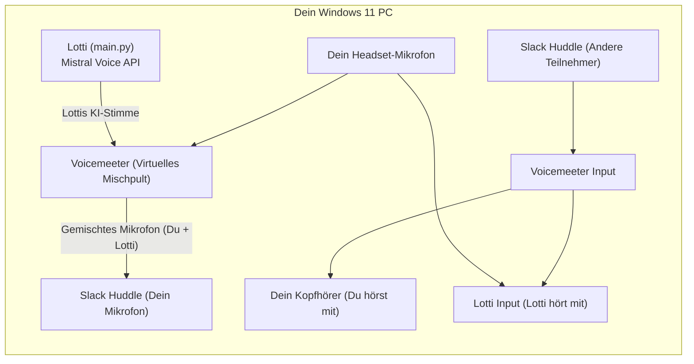

# Lotti — Live Voice Agent with Local LanceDB RAG (Windows 11)

**Lotti** is a proactive, real-time AI team member built on the **Mistral Realtime Voice API** (`mistralai[voice-agents]`) and a local **LanceDB** knowledge base (`C:\integriti\lancedb_data`). She listens to technical discussions in internal team/Slack calls, checks architectural constraints against internal Architecture Decision Records (ADRs), and provides concise voice feedback.

---

## Project Structure

- `config.py` — Strongly-typed configuration loader (`python-dotenv`) with Windows 11 defaults (`C:\integriti\...`).
- `prompt_loader.py` — Dynamic Markdown system prompt loader (`SystemPromptLoader`) with `st_mtime_ns` hot-reloading and working-memory composition.
- `rag_manager.py` — Local LanceDB connector (`RAGManager`), ADR seeding utility, technical keyword trigger detector, and async vector retrieval helper.
- `audio_utils.py` — Windows 11 `DefaultAudioInterface` setup, `PyAudio`/`PortAudio` device enumeration, and headless fallback handling.
- `main.py` — `LottiVoiceAgent` async event loop integrating `client.audio.sessions.init(...)`, `@function_tool` RAG tools, live transcript listeners, and graceful shutdown.
- `prompts/system_prompt.md` — Default modular system instructions template.
- `tests/test_lotti.py` — Automated test suite verifying prompt hot-reloading, LanceDB RAG retrieval, and voice session event handling.

---

## Windows 11 Setup & Installation

### 1. Prerequisites
- **Python 3.10+** (64-bit recommended for Windows 11)
- **Virtual Audio Routing for Slack**: [VB-CABLE Virtual Audio Device (A+B)](https://vb-audio.com/Cable/) or [Voicemeeter Banana](https://vb-audio.com/Voicemeeter/banana.htm).

### 2. Install Dependencies (PowerShell)
```powershell
python -m venv .venv
.\.venv\Scripts\Activate.ps1
pip install --upgrade pip
pip install -r requirements.txt
```
*(Note: Modern `pyaudio>=0.2.14` ships precompiled binary wheels for Windows 11 x64 that bundle PortAudio automatically.)*

### 3. Configure Environment Variables
Copy `.env.example` to `.env` and set your `MISTRAL_API_KEY`:
```powershell
Copy-Item .env.example .env
notepad .env
```

By default, Lotti uses:
- **System Prompt**: `C:\integriti\prompts\system_prompt.md` (created automatically on first run if missing)
- **LanceDB Storage**: `C:\integriti\lancedb_data` (created and seeded with sample ADRs on first run if empty)

### 4. Run a Local RAG Diagnostic Check
Verify that the Markdown prompt loader and LanceDB vector search work before joining a call:
```powershell
python main.py --test-rag "Can we use MongoDB or Redis for durable domain events?"
```

### 5. Start the Live Voice Agent
```powershell
python main.py
```
Edit `C:\integriti\prompts\system_prompt.md` at any time while Lotti is running—changes are detected and hot-reloaded automatically.

---

## Slack Huddle Integration in der Praxis (Windows 11)

Da Slack aktuell keine direkte Bot-API für WebRTC-Huddles anbietet, wird Lotti unter Windows 11 über **virtuelles Audio-Routing** in Slack-Calls eingebunden. Technisch wird Lottis Stimme direkt in Echtzeit von der **Mistral Realtime Voice API** (STT $\rightarrow$ LLM + lokales LanceDB-RAG $\rightarrow$ TTS) erzeugt und über `DefaultAudioInterface` ausgegeben.

Für die Einbindung in ein Slack-Huddle gibt es **zwei bewährte Varianten**:

### Variante 1: Lotti als eigener Teilnehmer im Slack-Huddle (Empfohlen)
Lotti erhält einen eigenen Slack-Account (z. B. `Lotti [Architecture AI]`) auf einem Windows-11-Rechner, Mini-PC oder einer Windows-VM.

1. **Zwei virtuelle Audiokabel nutzen (z. B. VB-CABLE A & B):**
   - **Leitung A (Huddle $\rightarrow$ Lotti hört zu):**
     - In **Slack** unter *Audio & Video $\rightarrow$ Lautsprecher*: `CABLE-A Input` auswählen.
     - Für **Lotti (`python.exe`)** im Windows-11-Lautstärkemixer als *Eingabegerät (Mikrofon)*: `CABLE-A Output`.
   - **Leitung B (Lotti spricht $\rightarrow$ Huddle hört sie):**
     - Für **Lotti (`python.exe`)** im Windows-11-Lautstärkemixer als *Ausgabegerät (Lautsprecher)*: `CABLE-B Input`.
     - In **Slack** unter *Audio & Video $\rightarrow$ Mikrofon*: `CABLE-B Output` auswählen.
2. **Ergebnis im Huddle:** Lotti erscheint mit eigener Kachel und eigenem Avatar im Slack-Huddle, hört allen Teilnehmern ohne Rückkopplung zu und spricht bei Architektur-Fragen direkt ins Huddle.

---

### Variante 2: „Sidecar“-Modus über deinen eigenen Slack-Account
Wenn kein eigener Slack-User für Lotti angelegt werden soll, läuft Lotti direkt auf deinem Windows-11-PC über **Voicemeeter Banana** (virtuelles Mischpult).

#### Woher kommt die Stimme bei Variante 2?
- **Technisch:** Die KI-Stimme wird weiterhin live von der **Mistral Realtime Voice API** über `main.py` generiert.
- **Im Slack-Huddle:** Da Lotti keinen eigenen Slack-Account nutzt, wird ihre Sprachausgabe in Voicemeeter mit deinem Headset-Mikrofon zusammengemischt. Für deine Kollegen im Huddle kommt Lottis KI-Stimme also **aus deiner Slack-Kachel** (dein Profilbild leuchtet beim Sprechen grün auf, während Lotti spricht).



#### Signalfluss im Call (Variante 2):
1. **Wenn du sprichst:** Deine Kollegen hören deine Stimme, und Lotti hört dich ebenfalls.
2. **Wenn deine Kollegen sprechen:** Du hörst sie auf deinem Kopfhörer, und Lotti hört sie gleichzeitig über die virtuelle Spur.
3. **Wenn Lotti antwortet:** Voicemeeter leitet Lottis Mistral-Stimme **gleichzeitig** auf deinen Kopfhörer (damit du sie hörst) **und** in deinen Slack-Mikrofonkanal (damit alle im Huddle sie hören). Durch `LOTTI_ECHO_CANCELLATION=true` und getrenntes Bus-Routing (`B1`/`B2`) in Voicemeeter hört Lotti sich dabei nicht selbst doppelt.
